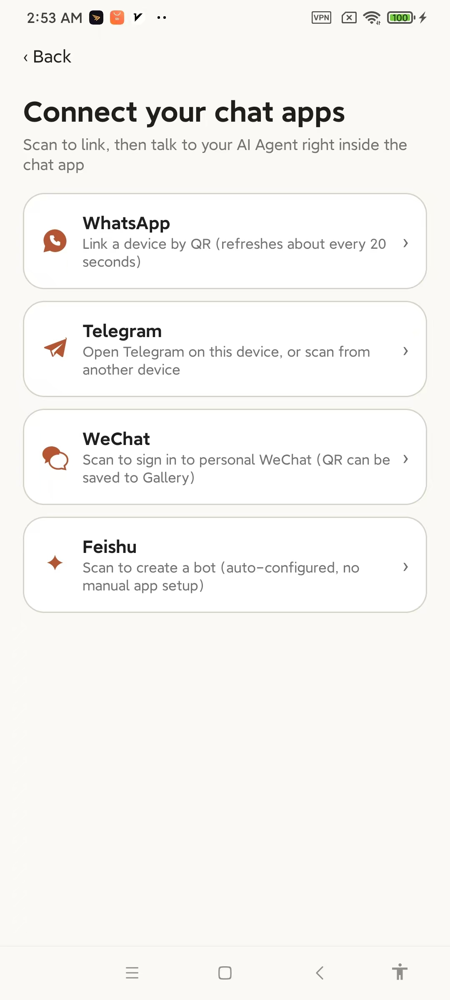
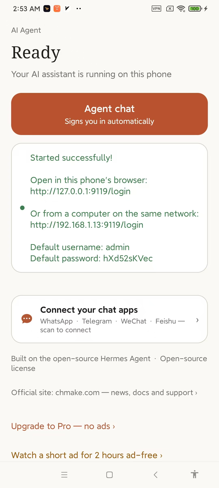

[English](README.md) | [简体中文](README.zh-CN.md)

# Hermes Agent on Android

**Turn your Android phone into an always-on AI agent — no root, no terminal, no technical setup.**

One APK installs Ubuntu and Hermes Agent in an isolated proot environment. You get a full web dashboard, an in-app terminal chat, and the ability to talk to your agent from WeChat, Feishu, Telegram or WhatsApp.

> Everything runs locally on your device. No cloud VM, no SSH tunnel, no command line.

## Why Hermes Installer

- **No root required** — Ubuntu runs in a proot sandbox inside the app's private storage. Your device stays untouched.
- **One-tap setup** — the app downloads the image, deploys Hermes Agent, restores a working config, and starts the gateway for you.
- **Real agent, not a chatbot shell** — full Ubuntu environment, terminal chat (TUI), tools, skills, sessions and memory.
- **Web dashboard on port 9119** — manage config, models and conversations from a browser, on the device or over your LAN.
- **Chat where you already are** — built-in channel setup for WeChat, Feishu, Telegram and WhatsApp. `/weixin-login` links WeChat in one command.
- **Stays running** — foreground service, wake lock and watchdog keep the gateway alive in the background.
- **Ready-to-use model** — a working default provider is configured out of the box; switch to any OpenAI-compatible provider or grab a free API key from our site.
- **Made for everyone** — 14 languages, two editions (China / international), clear on-screen guidance.

## What happens after install

1. The app downloads the Ubuntu rootfs and Hermes backup package.
2. It deploys Hermes Agent, restores the preset config and skills, and starts `hermes gateway` + `hermes dashboard`.
3. Open the dashboard, or the in-app chat, and start talking — no shell needed.

## Quick start

1. Download the latest APK from [Releases](../../releases).
2. Allow installation from unknown sources.
3. Open the app and follow the on-screen steps.
4. Enjoy a **3-day free trial**.

## Pricing

- **China**: ¥10/month at [hanhanhu.cn](http://hanhanhu.cn) (Alipay / WeChat Pay). Payment returns an activation code to enter in the app.
- **International**: subscribe through [Google Play](https://play.google.com/store/apps/details?id=com.hermes.installer), or watch a rewarded ad to unlock a full ad-free day.
- After the trial, the international edition keeps working with ads; the China edition uses activation codes.
- Need a model key? See the [free API key guide](https://hanhanhu.cn/free-api.html). You can also bring your own provider.

## Requirements

- Android 8.0+ (API 26), arm64-v8a
- About 3 GB free storage (setup downloads ~410–470 MB; the installed environment uses ~1.8–2.9 GB)
- Internet connection for the initial download, license check and model calls
