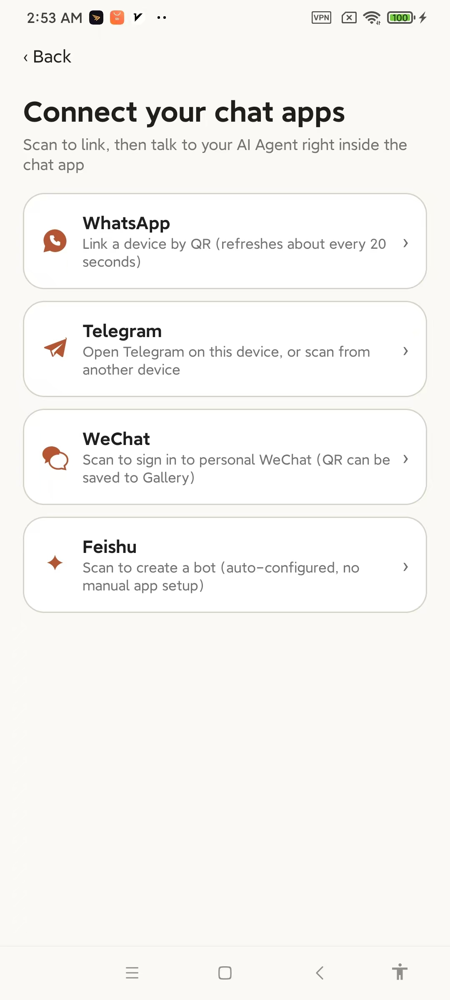
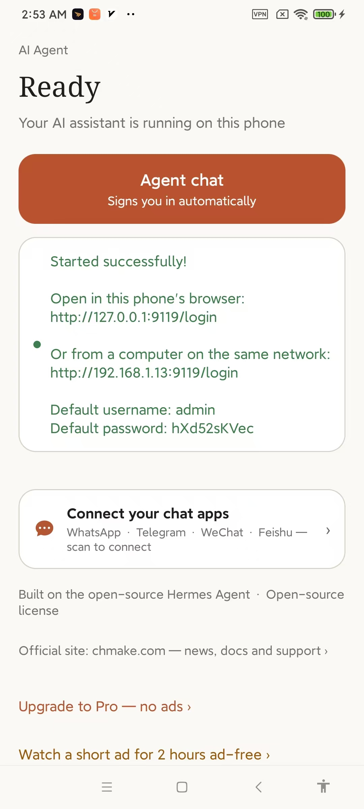

[English](README.md) | [简体中文](README.zh-CN.md)

# Hermes Agent on Android

**把你的安卓手机变成一台常驻 AI Agent —— 无需 root、无需命令行、零技术门槛。**

一个 APK 在独立的 proot 沙箱里装好 Ubuntu 和 Hermes Agent，直接给你 Web 控制台、内置终端对话，以及微信 / 飞书 / Telegram / WhatsApp 四个聊天通道。

> 一切跑在你自己的设备上，不需要云服务器，不需要 SSH 隧道，不敲一行命令。

## 为什么选我们

- **无需 root**：Ubuntu 跑在 App 私有目录的 proot 沙箱里，不改动手机系统。
- **一键安装**：自动下载环境包、部署 Hermes Agent、恢复预设配置并启动网关，全程跟着提示点即可。
- **真 Agent，不是聊天壳**：完整 Ubuntu 环境、TUI 终端对话、工具、技能、会话与记忆。
- **浏览器控制台**：9119 端口的 Web Dashboard，手机本地或局域网内都能管理配置、模型和对话。
- **在你常用的 App 里聊天**：内置微信 / 飞书 / Telegram / WhatsApp 通道配置，微信用 `/weixin-login` 一条命令绑定。
- **后台常驻**：前台服务 + WakeLock + 看门狗，网关在后台持续运行。
- **开箱可用的模型**：预置一套默认提供商，也可换任意 OpenAI 兼容接口；官网提供免费 API Key 申请指引。
- **为普通人设计**：14 种语言、国内/国际双版本、全程中文引导。

## 安装后你会得到什么

1. App 自动下载 Ubuntu rootfs 与 Hermes 备份包。
2. 部署 Hermes Agent、恢复预设配置与技能，启动 `hermes gateway` + `hermes dashboard`。
3. 打开 Web 控制台或内置对话即可使用，不需要任何终端操作。

## 快速开始

1. 到 [Releases](../../releases) 下载最新 APK。
2. 允许「安装未知来源应用」。
3. 打开 App，按提示完成安装。
4. 新用户享 **3 天免费试用**。

## 价格与解锁

- **国内版**：[hanhanhu.cn](http://hanhanhu.cn) ¥10/月，支持微信 / 支付宝，付款后获得激活码，在 App 内填写即可。
- **国际版**：通过 [Google Play](https://play.google.com/store/apps/details?id=com.hermes.installer) 订阅，也可看激励广告解锁全天无广告。
- 试用结束后国际版可继续免费使用（带广告），国内版使用激活码解锁。
- 没有模型 Key？看[免费 API Key 申请指引](https://hanhanhu.cn/free-api.html)，也支持填入自己的服务商。

## 运行环境

- Android 8.0 及以上（API 26），arm64-v8a
- 约 3 GB 可用存储（安装需下载 410–470 MB，装好后占用约 1.8–2.9 GB）
- 联网：首次下载、授权校验和模型调用需要网络
